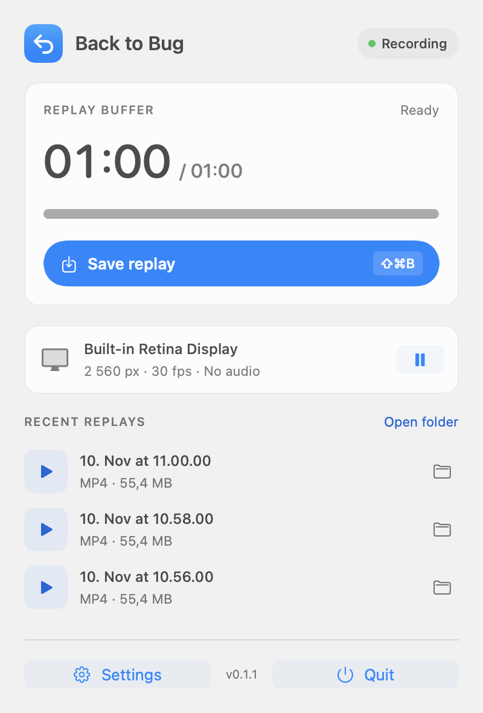
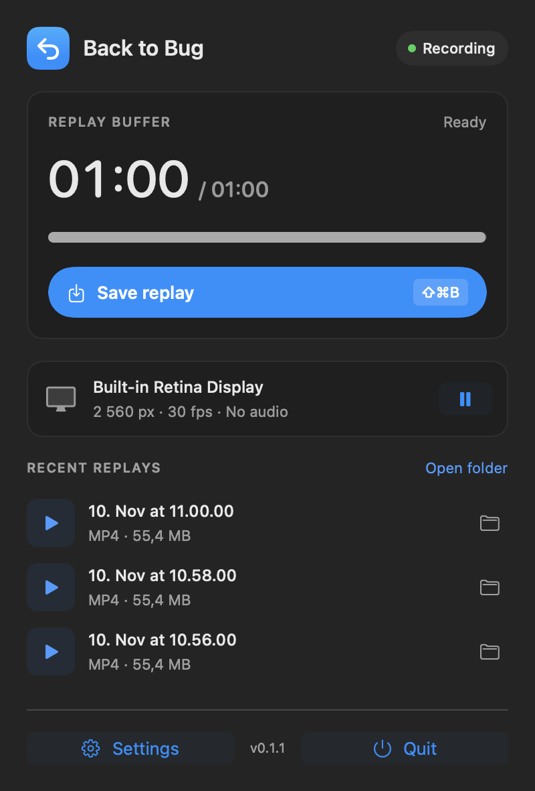

# Back to Bug

**Found a bug? Save how you got there.**

Back to Bug keeps a rolling recording of your screen. Press **⌘⇧B** or click **Save replay** in the menu bar to save the last 60 seconds as an MP4. Attach it to your bug report without having to reproduce the bug again.

[**Download for macOS**](https://github.com/skarpovdev/backtobug/releases/latest) · [Report a bug](https://github.com/skarpovdev/backtobug/issues) · [Contribute](#contributing)

Free and open source under the [MIT license](LICENSE). Requires **macOS 14 or newer**. One universal download for Apple Silicon and Intel Macs.

<p>
  
  
</p>

*UI previews with sample replay entries.*

## Install

1. Download the `.dmg` from the [latest release](https://github.com/skarpovdev/backtobug/releases/latest).
2. Open it and drag **Back to Bug** into **Applications**.
3. Launch the app. It lives in the macOS menu bar.
4. Click **Enable screen recording** and allow Back to Bug in **System Settings → Privacy & Security → Screen Recording** (called **Screen & System Audio Recording** on newer macOS versions). Restart the app if macOS asks.

**Current releases are ad-hoc signed and are not notarized by Apple.** If macOS blocks the first launch, use **System Settings → Privacy & Security → Open Anyway** after attempting to open it. Only do this for a download you trust. SHA-256 checksum files are included with each release.

## Use it while testing

Let the buffer fill while you use the app you are testing. When something goes wrong, press **⌘⇧B** from any app, or open Back to Bug from the menu bar and click **Save replay**. Recording continues while the replay is saved.

Replays go to **`~/Movies/Back to Bug`** by default. Click a recent replay to play it, use its folder button to reveal it in Finder, or choose **Open folder** to see all saved videos.

Open **Settings** at the bottom of the panel to change:

| Setting | Options |
| --- | --- |
| Replay length | 5 seconds to 10 minutes; 60 seconds by default |
| Display | One selected display at a time |
| Quality | Efficient, Balanced, or Extra sharp; up to 1920, 2560, or 3840 px on the longest side |
| Frame rate | 15, 30, or 60 fps |
| Pointer | Show the cursor and highlight clicks; click highlighting requires macOS 15+ |
| Save location | Choose a folder for your MP4 files |
| Shortcut | Choose your own global save shortcut |
| Startup | Launch at login and start recording automatically |

Click **Save changes** to apply your settings. Pause recording from the panel whenever you need to; pausing clears the rolling buffer.

## Privacy and limits

- **Local processing.** No accounts, uploads, analytics, or network requests. Screen recording and video encoding happen on your Mac.
- **A rolling buffer in memory.** Encoded video stays in RAM until you save a replay. Older frames are discarded automatically. Saved replays remain in your chosen folder until you delete them.
- **Screen access is broad.** The selected display can include other apps and sensitive content. Back to Bug excludes its own windows from capture.
- **Video only.** Replays are H.264 MP4 files without microphone or system audio.
- **A bounded buffer.** Encoded video is capped at 512 MiB. Long durations and high quality can reduce how much history fits. The panel shows the actual available duration; a new recording also needs time to fill.
- **A fresh buffer after interruptions.** Sleep, screen lock, display changes, and capture-setting changes can clear or restart the buffer.

The app is currently **macOS only**.

## Troubleshooting

**Screen access is enabled, but recording still fails**

Quit and reopen Back to Bug after granting permission. If the problem starts after replacing or rebuilding the app, remove its old entry from Screen Recording settings, add the current app from Applications, and reopen it. Ad-hoc builds can have different code signatures, so macOS may require permission again.

**The shortcut does not save a replay**

Check that recording is active and the buffer contains video. If Settings reports that the shortcut is unavailable, choose another combination; another app may already use it. You can also save from the menu bar.

**The saved clip is shorter than the chosen length**

The app can only save the history currently in its buffer. Wait for it to fill, or lower the quality, frame rate, or replay length if the memory cap is reached.

## Build from source

You need macOS and the full **Xcode 16.4 or newer** installation, with its command-line tools selected. CI uses Xcode 16.4. The project uses Swift Package Manager and has no external package dependencies.

```sh
git clone https://github.com/skarpovdev/backtobug.git
cd backtobug
swift test
bash scripts/build.sh
open "dist/Back to Bug.app"
```

The build produces a universal app bundle, an installable DMG, and a `.sha256` file in `dist/`. Grant Screen Recording permission to the built app to test live capture.

To create a signed and notarized distribution, provide your Developer ID signing identity and an existing `notarytool` Keychain profile:

```sh
SIGNING_IDENTITY="Developer ID Application: Your Name (TEAMID)" \
NOTARY_PROFILE="your-notary-profile" \
bash scripts/build.sh
```

Without those values, the script creates an ad-hoc signed local build.

### How it works

ScreenCaptureKit captures the selected display. VideoToolbox encodes frames as H.264, and a rolling buffer retains recent encoded frames. Saving takes a snapshot of that buffer and writes an MP4 through AVFoundation.

| Location | Responsibility |
| --- | --- |
| `Sources/BackToBug` | SwiftUI/AppKit interface, screen capture, settings, and global shortcut |
| `Sources/ReplayCore` | Video encoding, rolling buffer, and MP4 export |
| `Tests/ReplayCoreTests` | Buffer retention, memory limits, and encode/export tests |
| `scripts/build.sh` | Universal app, signing, DMG, and checksums |
| `.github/workflows/build.yml` | Tests and builds for pushes and PRs; releases for version tags |

## Contributing

Bug reports, fixes, and UI improvements are welcome. You can fork the project, modify it, and distribute your changes under the MIT license.

1. [Fork the repository](https://github.com/skarpovdev/backtobug/fork) and clone your fork.
2. Create a branch from the latest `main`, for example `skarpov/fix-shortcut`.
3. Keep the change focused. Run `swift test` and `bash scripts/build.sh`. For capture, shortcut, or UI changes, also try the built app on macOS.
4. Open a pull request against `main`. Describe the problem, the change, and how you checked it. Include a screenshot for visible UI changes when useful.

For a substantial feature, open an issue first so we can agree on the scope. There is no contributor agreement to sign; contributions are provided under this repository's MIT license.

When [reporting a bug](https://github.com/skarpovdev/backtobug/issues/new), include the app version, macOS version, Mac model, capture settings, reproduction steps, and any error shown in the panel. Check a replay for private information before attaching it.

## License

[MIT](LICENSE) © 2026 Sergey Karpov.
